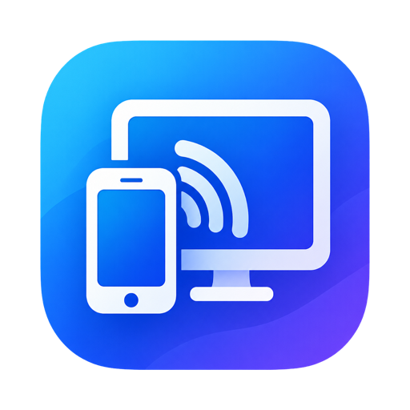
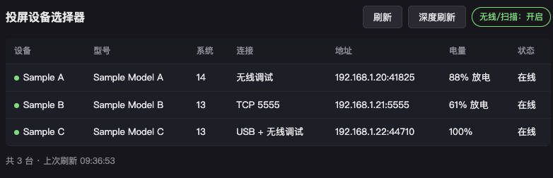

  

# 投屏设备选择器 · scrcpy device picker

一句话：**把手机列成一张表，双击一行就投屏**。

它自动发现插在 USB 上、或和你在同一个 Wi-Fi 里的 Android 设备，帮你避开 scrcpy 每次都要
`adb devices` 抄序列号、无线端口又老变的麻烦；还给没有全屏手势的手机补一条
**返回 / 桌面 / 多任务 / 音量 / 息屏 / 唤醒** 的导航按钮条。

- **Windows**：原生 C# / WPF 程序（Fluent 风格控件表格 + 服务层直接调度 adb/scrcpy），self-contained 单 exe，
  双击即用、零 PowerShell / 浏览器 / .NET 依赖。
- **macOS**：原生 Swift 程序（SwiftUI 原生界面 + 进程内服务 + adb/scrcpy 调度），打包成一个
  `ScrcpyPicker.app`，**32 MB**，双击即用、零依赖。另带**文件互传**：拖文件到设备行即推送到手机
  `/sdcard/Download`，右键设备行可把 `Download / DCIM / Pictures` 拉回本机 `~/Downloads`。

## 下载

到 [Releases](https://github.com/souvenirding/scrcpy-device-picker/releases/latest) 下载对应平台的 zip：

| 平台 | 文件 | 系统要求 |
|---|---|---|
| macOS (Apple Silicon) | `ScrcpyPicker-<ver>-arm64.zip` | macOS 13.0+ |
| Windows (x64) | `ScrcpyPicker-<ver>-win64.zip` | Windows 10/11 x64 |

zip 自带 adb 与 scrcpy，解压即用，无需安装任何运行时。

> 上图为 **macOS 版**的界面（**虚构示例设备**，取自 `shared/devices.example.json`），仅演示布局，不含任何真实设备信息。
> Windows 版是原生 WPF 表格，列一样是「设备 / 型号 / 系统 / 连接 / 地址 / 电量 / 状态」，双击与右键的操作完全相同。

两端都有导航按钮条：**macOS** 检测到有 scrcpy 在投屏时，屏幕底部居中浮出这条 HUD（可拖到任意位置，全部投屏窗口关闭后自动收起）；
**Windows** 的按钮条吸附在投屏窗口的下边缘、与窗口同宽，跟着窗口一起移动（按住空白拖一下就脱离吸附变成悬浮条，双击重新吸附）。

> 图为 macOS 的 HUD 形态；Windows 是吸附跟随投屏窗口的形态，按钮一样是这七颗。

---

## 它能做什么

| 功能 | 说明 |
|---|---|
| 三通道自动发现 | USB 序列号 / mDNS 无线调试（Android 11+）/ 全子网 5555 扫描，结果合并成一行 |
| 双击投屏 | 自动选通道，优先级：USB → 无线调试 → 5555；同一台设备重复双击**复用**已开窗口，不重开（要重开就用右键「强制重新投屏」） |
| 导航按键 | 返回 / 桌面 / 多任务 + 音量- / 音量+ / 息屏 / 唤醒；**两端**都是投屏时出现的导航按钮条（macOS 浮动 HUD / Windows 吸附跟随投屏窗口），也都能从设备行的右键菜单单发（都是 `adb shell input keyevent`） |
| 右键菜单 | 指定通道投屏、**投屏（不同步剪贴板）**、唤醒屏幕、单发按键、重连、断开无线、备注名、复制地址、移除 |
| 自动刷新 | 两端都是每 10 秒刷一次快照；关掉选择器窗口就是退出（已开着的投屏窗口不受影响，下次打开会认领回来） |
| vivo 手动兜底 | OriginOS 删了无线调试页面，需手动开「无线调试」并配对，或 USB 执行 `adb tcpip 5555` 后用 IP 连接（原生版暂无自动补开关） |

---

## 快速上手

### Windows

**双击 `ScrcpyPicker.exe` 就能用** —— 它是一个自包含的单 exe（.NET 运行时已打进包里，界面是原生 WPF 控件），
旁边配一个 `tools\` 目录放 `adb.exe` 和 `scrcpy.exe` 即可，不需要装 PowerShell、不需要浏览器、不需要另装 .NET。
换电脑时直接拷 `ScrcpyPicker-win-x64.zip`（`build.ps1` 一键产出：exe + 整个 `tools\` + 一份换机说明），
解压即用，中途不用找任何依赖。安装版 `ScrcpyPicker-Setup-x64.exe` 会把 exe 与 `tools\` 一起装好。

> 只有设备备注名等配置留在 `%APPDATA%\ScrcpyPicker\devices.json`，不在这个压缩包里；要迁走单独拷那一个文件。

忘了配 `tools\` 也不会卡住：exe 会接着找 `SCRCPY_TOOL_DIR` / `-tools`、上次记住的目录、`PATH`、
Android SDK 与 scrcpy 的常见安装位置，最后在固定盘里做一次受限深度搜索，命中就记进配置；
界面顶部的「工具目录」面板也能手工指定或点「自动搜索」。

> 单文件 exe 首次运行会解包一次（比之后几次慢一两秒）；不支持 Mica 的旧系统上窗口会退成普通底色，功能不变。

源码构建与打包见 [packaging/windows/README.md](packaging/windows/README.md)。

### macOS

**双击 `ScrcpyPicker.app` 就能用，不装任何东西** —— app 是纯原生 Swift 程序（不打包 PowerShell），
`adb` 和 `scrcpy` 直接内嵌，整个 app **32 MB**（zip 分发约 14 MB），自带原生窗口，不需要浏览器。
第一次打开若被 Gatekeeper 拦，**右键 → 打开** 绕过一次即可。

只有**从源码重新打包 `.app`** 时才需要准备工具（Xcode Command Line Tools 的 `swiftc` + 官方
scrcpy macos-aarch64 解压包，默认放 `~/scrcpy-tools`），构建步骤见
[安装配置与打包](docs/setup-and-packaging.md)。

> 依赖细节、`SCRCPY_TOOL_DIR`、打包 `.app` / 安装包，都在 [安装配置与打包](docs/setup-and-packaging.md)。

---

## 怎么用

- **双击一行** = 投屏（自动选通道：USB → 无线调试 → 5555）
- **右键一行** = 更多操作：指定通道投屏、投屏（不同步剪贴板）、**强制重新投屏**、唤醒、单发返回/桌面/多任务、重连、断开无线、备注名、复制地址、移除
  （离线行只留「备注名 / 复制地址 / 移除」三项）
- **投屏时出现的按钮条** = 返回 / 桌面 / 多任务 / 音量± / 息屏 / 唤醒；关掉投屏窗口它自动收掉。
  **macOS** 是屏幕底部居中的浮动 HUD，可拖到任意位置；**Windows** 吸附在投屏窗口下沿、与窗口同宽并跟随移动，
  按住空白处拖动可变成悬浮条、双击恢复吸附，工具条上的「导航条」开关可整体关掉
- **关掉程序**（Windows）= 直接退出，每 10 秒的自动刷新随之停止；已经开着的 scrcpy 窗口不受影响，下次打开选择器会把它认领回来

导航条按键对应关系：

| 按钮 | Android 键码 | 说明 |
|---|---|---|
| 返回 | 4 | 退一层，退到顶回桌面 |
| 桌面 | 3 | 直接回启动器 |
| 多任务 | 187 | 最近任务卡片 |
| 音量- / 音量+ | 25 / 24 | |
| 息屏 / 唤醒 | 223 / 224 | 投屏不断开，只黑屏 / 点亮 |

键盘党（scrcpy 自带）：投屏窗口里 **Alt+B**=返回、**Alt+H**/中键=桌面、**Alt+S**=多任务、**Alt+O**=息屏、鼠标右键=返回。

---

## 新设备第一次连不上？

**从没配对过的手机，这里就是扫不到**——它既不广播 mDNS、也不监听 5555，这是 Android 的安全设计，每台手机只需入库一次：

- **Android 11+**：开发者选项 → 无线调试 → 使用配对码配对 → 在选择器「配对向导」里填配对端口 + 6 位码。
- **Android 10 及以下**：插 USB 执行 `adb tcpip 5555`，之后走子网扫描（每次重启手机要重做）。
- **vivo / OriginOS**：没有无线调试页面，插 USB 后在开发者选项里手动开「无线调试」并配对，或执行
  `adb tcpip 5555` 后用 IP 连接（原生版暂无自动补开关，需手动操作）。

完整步骤、四个常见"找不到"的坑、以及**小米/HyperOS 按键无效要额外开「USB 调试（安全设置）」**，
都在 [配对与排错](docs/pairing-and-troubleshooting.md)。

---

## 安全提醒

- **剪贴板**：双向同步会把电脑剪贴板内容直接写进手机，手机任何 App 都能读到。复制密码/密钥时用右键的「投屏（不同步剪贴板）」。
- **网络**：不要把 5555 或无线调试端口映射/转发到公网，只在局域网里用；不可信 Wi-Fi 上请关掉无线调试。

---

## 更多文档

- [安装、配置与打包](docs/setup-and-packaging.md) —— 环境、目录结构、工具路径解析、编码规则、`.app` / `Setup.exe` 打包
- [配对与排错](docs/pairing-and-troubleshooting.md) —— 发现原理、入库配对 A/B/C、常见坑、厂商限制
- [开发者笔记](docs/dev-notes.md) —— 文件清单、macOS 架构、导航条吸附机制、WPF/Swift 实现踩坑、已知限制

---

## License

本项目采用 **Apache-2.0** 许可证，详见 [`LICENSE`](LICENSE)。

- 不修改 [scrcpy](https://github.com/Genymobile/scrcpy) 源码，只调用它自带的 `scrcpy.exe` / `adb.exe` 完成设备发现与投屏；scrcpy 版权归 Genymobile，同样采用 Apache-2.0，请遵守其上游许可并保留版权声明。
- `assets/picker.ico` 由 scrcpy 官方图标转换而来，权利归属随上游；公开分发时请一并保留此来源说明。
